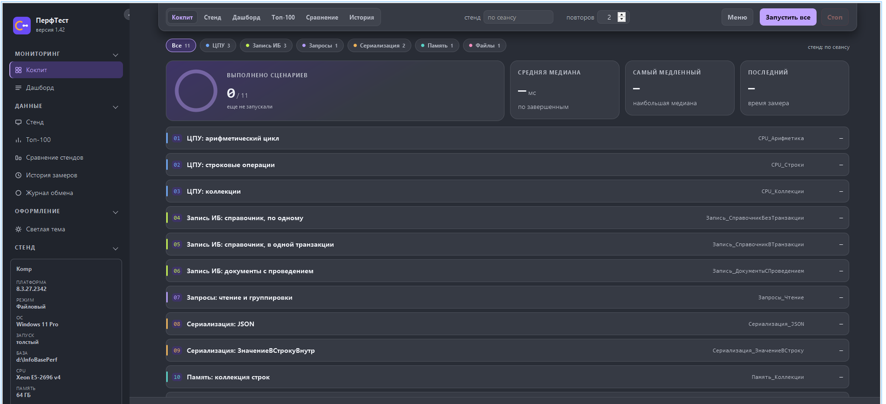
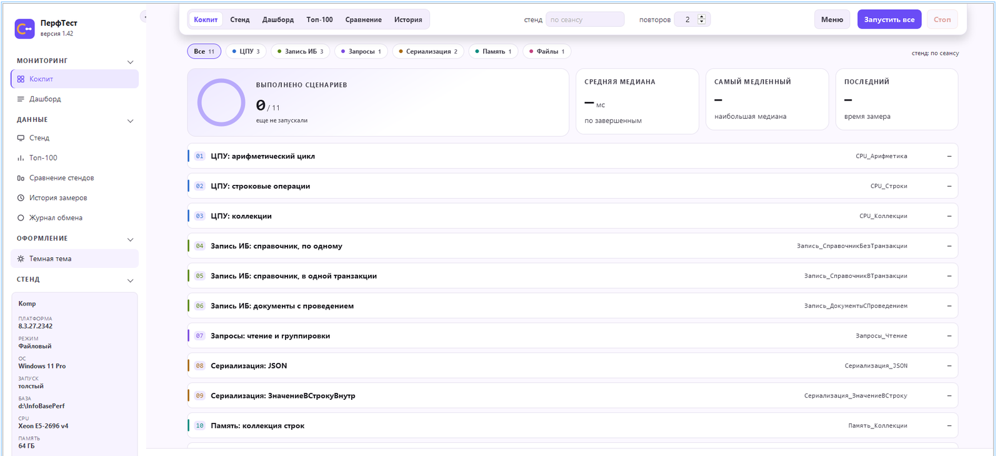
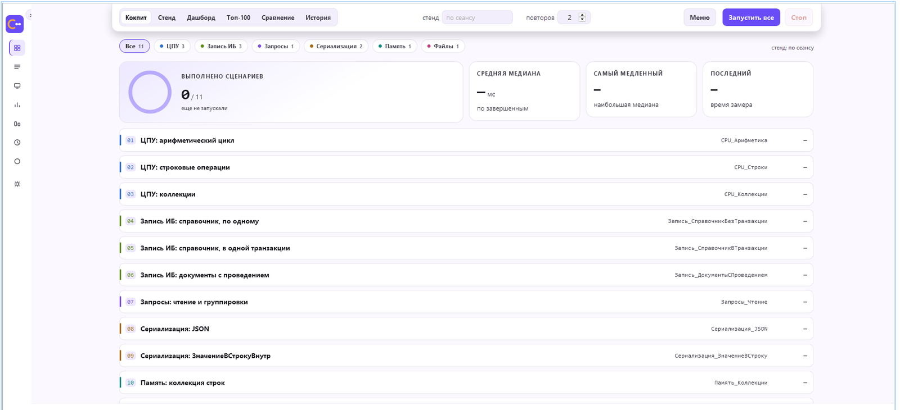
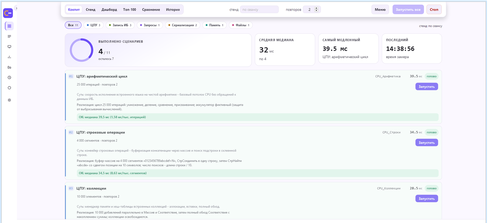
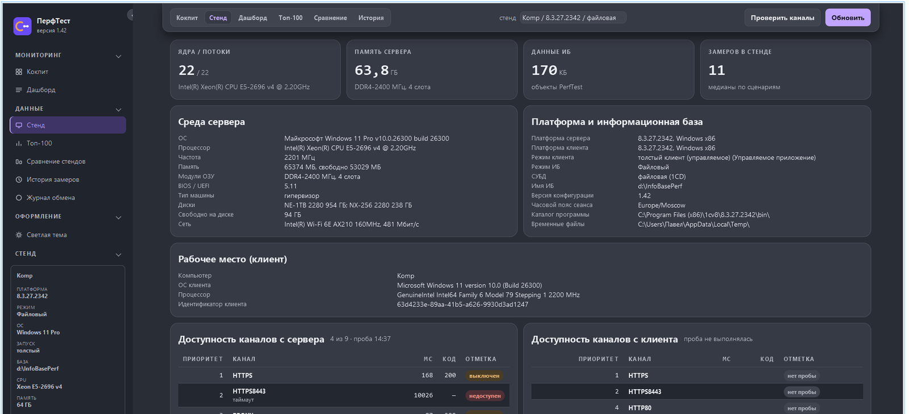
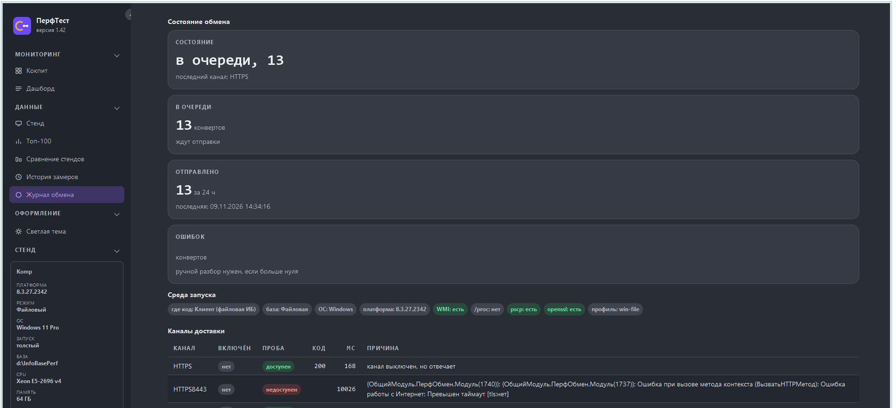

# PerfTest — конфигурация сравнительных замеров производительности 1С

[](https://github.com/azxasd69/perftest/actions/workflows/ci.yml)
[](CHANGELOG.md)
[](LICENSE)

Конфигурация 1С:Предприятие 8.3, которая измеряет скорость типовых операций на разных
стендах, сборках платформы и режимах клиента, сводит замеры в медианы, нормирует их на
объём работы и складывает в регистры — с кокпитом, отчётами, дашбордом, автоматически
собираемым паспортом стенда и выгрузкой результатов на портал.

> **Это инструмент сравнения, а не аттестация железа.** Он отвечает на вопрос «стало ли
> быстрее на этом стенде относительно базы сравнения», а не «хорош ли этот сервер в
> абсолюте». Абсолютные числа сопоставимы между машинами только при одинаковой версии
> конфигурации и одинаковых объёмах работы.

## Содержание

- [Что внутри](#что-внутри)
- [Требования](#требования) · [Быстрый старт](#быстрый-старт)
- [1. Кастомный интерфейс: как сделана «красота»](#1-кастомный-интерфейс-как-сделана-красота)
- [2. Данные о сервере и клиенте](#2-данные-о-сервере-и-клиенте-паспорт-стенда)
- [3. Обмен с порталом](#3-обмен-с-порталом)
- [4. Работоспособность и переносимость](#4-работоспособность-и-переносимость)
- [Состав репозитория](#состав-репозитория) · [Гейты](#гейты) · [Документация](#документация)

## Что внутри

| | |
|---|---|
| Сценариев | 11 (ЦПУ, запись в ИБ, запросы, сериализация, память, файловый ввод-вывод) |
| Метрика | медиана прогонов и «мс на 1000 единиц работы» — нормировка на порцию |
| Интерфейс | кокпит с 11 карточками, 4 отчёта, дашборд, карточка стенда, журнал обмена, палитра команд, светлая и тёмная темы |
| Паспорт стенда | 71 реквизит, схема 3: конвейер «среда → план → блоки», две фазы, WMI на Windows, `/proc` на Linux |
| Обмен | push-конверты результатов и паспортов на портал [perfd](https://github.com/azxasd69/perfd); 9 каналов доставки, идемпотентность, оффлайн-очередь |
| Режимы запуска | интерактивно, автопрогон `/C ПерфАвтоПрогон`, смоук форм, живой UI-сценарий мышью |

Чего здесь нет: клиент-серверных баз (проверялась только файловая ИБ), публикации на
веб-сервере, UI-автотестов и сторонних интеграций — конфигурация замкнутая.

## Требования

- Windows (платформа 1С поставляется x86, COM-коннектор — 32-бит).
- Платформа **8.3.27.2342** — основная: её же требует XML-обмен с 1C:EDT (формат 2.20).
  Проверено и на **8.5.4.1306**, но она повышает формат базы — для неё нужна отдельная копия.
- Файловая информационная база.
- PowerShell 7 (`pwsh`) для инструментов в `tools/`.
- Лицензия 1С (замеры идут в обычном сеансе; комьюнити-лицензии достаточно).

## Быстрый старт

```powershell
# 1. создать пустую файловую базу
pwsh -File tools\ib.ps1 -Action create -Base d:\InfoBasePerf -PlatformVersion 8.3.27.2342

# 2. загрузить конфигурацию из выгрузки
pwsh -File tools\ib.ps1 -Action load -Base d:\InfoBasePerf -Dir src -PlatformVersion 8.3.27.2342

# 3. проверить модули
pwsh -File tools\ib.ps1 -Action check -Base d:\InfoBasePerf -PlatformVersion 8.3.27.2342

# 4. загрузить расширение оформления (без него окно останется «не покрашенным»)
pwsh -File tools\ext-load.ps1 -Base d:\InfoBasePerf -Ext ext\PerfStyle -Name PerfStyle

# 5. открыть базу и нажать «Запустить все» на стартовой странице
& "C:\Program Files (x86)\1cv8\8.3.27.2342\bin\1cv8.exe" ENTERPRISE /Fd:\InfoBasePerf
```

Автопрогон без интерфейса (11 сценариев, маркеры в `%LOCALAPPDATA%\Temp\perftest_marker.log`):

```powershell
& "C:\Program Files (x86)\1cv8\8.3.27.2342\bin\1cv8.exe" ENTERPRISE /Fd:\InfoBasePerf /CПерфАвтоПрогон;;0;1
```

---

## 1. Кастомный интерфейс: как сделана «красота»



*Кокпит: тёмная тема, развёрнутое меню, сводные плитки, 11 карточек-строк, статусная строка.*

### 1.1. Носитель — поле HTML-документа, а не элементы формы

Весь интерфейс живёт в поле HTML-документа; у всех семи форм интерфейса оно есть:
`НачальнаяСтраница`, `ПерфДашборд`, `ПерфСтенды`, `ПерфИсторияЗамеров`,
`ПерфТопКонфигураций`, `ПерфСравнениеСтендов`, `ПерфОбменЖурнал`.

Разметка не рисуется в конструкторе формы — она **генерируется общими модулями**:

| Модуль | Что собирает |
|---|---|
| `ПерфUI` | библиотека оформления: `Стили`, `Страница`, `Документ`, `Плитка`, `Бейдж`, `Таблица`, `Меню`, `Иконка`, `Шапка`, `СкриптМоста`, экранирование |
| `ПерфКокпит` | каркас кокпита, 11 карточек, палитра команд, `СкриптКокпита` |
| `ПерфОтчетыHTML` | страницы отчётов Р1–Р3 и дашборда (плитки, блоки, таблицы, графики) |
| `ПерфСтендыHTML` | карточка стенда: блоки «среда», «платформа и ИБ», «рабочее место», «каналы», «замеры», «что не собрано», «диагностика» |

Три правила, без которых это не работает:

1. **Только полный HTML-документ.** Поле принимает страницу целиком; фрагмент, начинающийся
   со `<style>`, оно трактует как адрес и показывает «Couldn't resolve host name». Поэтому есть
   единственный сборщик `ПерфUI.Документ` — все страницы обязаны идти через него, своя вёрстка
   у страниц не пришивается (только 7 правил CSS на отчёты).
2. **Общий каркас.** Боковая навигация, тема, шапка, статусная строка задаются один раз в
   `Документ`, поэтому переход между страницами не перерисовывает «рамку».
3. **Иконки — inline SVG с `currentColor`.** Внешних файлов нет: тема перекрашивает иконки
   автоматически, лишних запросов нет.

### 1.2. Темы: токены и класс на `<html>`

Палитра — CSS-переменные `--pf-*` (фон, поверхности, линии, три уровня текста, акцент,
состояния ok/warn/bad/info, тени, цвета шести категорий сценариев). Светлая тема — базовые
значения на `html`, тёмная — блок `html.pf-dark`, который переопределяет **только цвета**:

| Токен | Светлая | Тёмная |
|---|---|---|
| `--pf-bg` | `#FBF8FF` | `#292D36` |
| `--pf-surface` | `#FFFFFF` | `#363A44` |
| `--pf-hover` | `#F6F2FF` | `#484D56` |
| `--pf-accent` | `#6A4CF6` | `#C0A4FF` |

Три решения, которые заметны на скриншотах:

- **Тему ставит сервер в разметке**, а не скрипт: `Документ` подставляет класс `pf-light` или
  `pf-dark` по константе `ПерфТемаСветлая`. Иначе поле HTML рисует страницу до выполнения JS, и
  дочерние страницы открывались бы «не той» темой.
- **Переключение — это один класс**: клик по пункту «Тема» меняет класс на `<html>`, отправляет
  в 1С команду `theme:<light|dark>` и сохраняет выбор в константу. Ни одна страница не
  перезагружается.
- **Тени тоже токены** (`--pf-shadow-tile`, `--pf-shadow-bar`): на графите тень глубже, на
  светлом — мягче; подъём плитки и тень шапки настраиваются отдельно на тему.



*Та же страница в светлой теме: меняются только значения токенов, разметка одна.*

### 1.3. Меню: развёрнуто и свёрнуто до рейла

Семь пунктов (`Кокпит`, `Дашборд`, `Стенд`, `Топ-100`, `Сравнение стендов`, `История замеров`,
`Журнал обмена`) сгруппированы в «Мониторинг» и «Данные». Свёрнутое состояние — это класс
`body.pf-collapsed`, который пересчитывает геометрию целиком:

| Элемент | Развёрнуто | Свёрнуто |
|---|---|---|
| боковая панель | 272 px | 60 px (рейл иконок) |
| контент | `padding-left: 284px` | `76px` |
| шапка | `left: 284px` | `76px` |
| статусная строка | `left: 272px` | `60px` |

Состояние хранится в константе `ПерфПанельСвернута`, клик отправляет `nav:collapsed|expanded` —
то есть после перезапуска сеанса панель выглядит так же, как её оставили.



*Свёрнутое меню: остаётся рейл иконок, контент и шапка сдвигаются, ничего не «прыгает».*

### 1.4. Шапка и статусная строка: fixed + распорка

Закрепление через `position: sticky` в этом движке не работает: прокрутку выполняет само поле,
`window.scrollY` и `body.scrollTop` всегда 0. Проверили и выбрали другой путь:

- шапка — `position: fixed` с `left` под меню, ширина колонки ограничена 1500 px;
- в потоке её заменяет распорка `#barspace`, высоту которой ставит `pfBar()` по `load`,
  `resize` и таймерам (шапка меняет высоту при сужении окна);
- статусная строка — отдельный `fixed`-блок снизу, текст ставится из 1С
  (`PF1C.status` / `SetGlobalStatus`).

### 1.5. Что движок HTML-поля не умеет и чем заменили

| Ограничение | Обход |
|---|---|
| нет `flex-gap`, `oklch`, `color-mix`, `clamp`, `backdrop-filter` | раскладка на grid + `margin`, цвета только в hex/rgb |
| `:focus-visible` бросает исключение | класс `kbd` на `<html>` по `Tab`, снимается по `mousedown`; фокус рисуется `outline` |
| `sticky` не липнет | `fixed` + распорка (см. 1.4) |
| свойство `Height` поля игнорируется, поле схлопывается в полосу | `VerticalStretch` вместо `Height` |
| только системные шрифты | стек `Segoe UI` / `Consolas` |
| `PrintWindow` не снимает содержимое поля (WebKit рисует в отдельной поверхности) | снимки для README и проверок — `CopyFromScreen` по прямоугольнику окна |
| анимация `width` у заливки не разрешалась | заливка прогресса через `transform: scaleX` |
| `will-change` даёт дрожание текста | не используем; `translateY` при наведении убран |

### 1.6. Динамика и отзывчивость

**Мост PF1C.** Клики и ввод не «прибиты» к разметке: у элемента есть атрибут `data-pf`
(`open:`, `send:`, `run:`, `runall`, `pal`, `theme`, `filter`, `sec`, `nav:`) или
`data-pf-field` для полей. Один делегированный обработчик в мосте разбирает команду и кладёт
строку в очередь `window.PF1C`; 1С забирает очередь таймером и выполняет. Неизвестная команда
пишется в консоль — опечатка не проглатывается молча.

Почему очередь, а не прямой вызов: из HTML-поля нельзя вызвать серверный метод, а
перерисовывать разметку на каждый чих дорого. Очередь дешёвая и переживает перерисовку
`innerHTML` (палитра).

**Интервалы.** Периодический обработчик платформа разрешает не чаще 1 с, поэтому он однократный
и переподключает себя сам:

| Что | Интервал |
|---|---|
| опрос моста во время прогона | 0,25 с |
| опрос моста в покое | 2 с |
| опрос прогресса фонового прогона | 0,3 с |
| тик автодосылки обмена | каждые 30 тиков (~60 с) |

**Ощущение скорости** делается на клиенте **до** ответа 1С: `run(n)` сразу ставит состояние
`state-run`, блокирует кнопки и только потом отправляет команду; `all()` блокирует всё до первой
команды; `end()` снимает блокировку (очередь пуста, отмена, сбой). Поэтому кнопка «Стоп»
доступна весь прогон, а «Запустить все» гаснет сразу.

**Состояния карточки:** `state-idle` → `state-run` → `state-ok` / `state-err` / `state-cancel`;
прогресс — заливка `.fill` через `transform: scaleX`, результат — медиана и строка
«ОК: медиана N мс (K мс/тыс.)». KPI-кольцо — `stroke-dashoffset` с переходом 0,5 с; высота
строк подгоняется под окно (`--pf-row-h`, 46…58 px) по `resize`.



*Идёт прогон: 4 из 11, кольцо и KPI пересчитаны, карточки раскрыли результат, статус — «Выполняется тест: 5».*

**Почему наведение стало быстрым.** Замеры показали: перерисовка 16 плиток с тенью — 2 мс, то
есть узким местом была не отрисовка, а длительность перехода (120 мс фон / 200 мс тень). Переход
сведён к `0.04 s`, мёртвые правила удалены (−102 символа CSS). Заодно убраны `will-change`
(давал дрожание глифов) и `translateY` при наведении.

**Где были «дорогие секунды».** В пути отрисовки стоял WMI: один вызов профиля сервера — 2
COM-подключения и 5 WQL-запросов ≈ 1,2 с; страницы с ним стоили 4,9–6,2 с против 161 мс без
WMI. Лечили не оптимизацией WMI, а профилем сеанса из регистра. Итог: смоук шести форм — 5,9 с
вместо 28,9 с, страница отчёта ≈ 0,11 с вместо 4,9 с.

---

## 2. Данные о сервере и клиенте (паспорт стенда)



*Карточка стенда: KPI, среда сервера, платформа и ИБ, рабочее место, доступность каналов с сервера и с клиента.*

### 2.1. Что это и где лежит

Паспорт — запись регистра `ПерфСтенды`: одно измерение `Стенд` и **71 реквизит**, схема **3**.
Паспорт с меньшей схемой считается неактуальным и пересобирается один раз; при смене версии
конфигурации — тоже (готовность проверяется по трём условиям: непустой отпечаток,
`ВерсияКонфигурации = Метаданные.Версия`, `СхемаПаспорта >= 3`).

### 2.2. Конвейер: среда → план → блоки

```
ОпределитьСреду()  →  ПланСбора(Среда)  →  блоки по порядку  →  ДопПоля  →  запись
```

- **Среда** определяется без COM и без обхода файловой системы: семейство ОС по
  `СистемнаяИнформация.ТипПлатформы`, вариант ИБ, версия платформы.
- **План сбора** — таблица «Блок / Применим / Причина». Неприменимый блок **не вызывается
  вообще**: так WMI не дёргается на Linux, `/proc` не читается на Windows, а блок клиента не
  собирается, если клиентской строки нет. Причина пропуска уходит в «Замечания сбора» и видна
  на карточке в блоке «Что не собрано».
- **Блоки:** `Платформа`, `ИБ` — всегда; `СерверWin` — только Windows; `СерверLinux` — только
  Linux при наличии `/proc`; `Клиент` — если передана клиентская строка.

### 2.3. Источники данных

| Группа | Откуда берётся |
|---|---|
| Платформа | версия и разрядность платформы, режим клиента и запуска, тип подключения |
| Информационная база | имя ИБ, режим (файловый/серверный), строка соединения **без пароля**, размер данных, объём `1Cv8.1CD`, признак СУБД |
| Сервер, Windows | WMI: `Win32_OperatingSystem`, `Win32_Processor`, `Win32_ComputerSystem`, `Win32_BIOS`, `Win32_PhysicalMemory`, `Win32_NetworkAdapter`, `Win32_DiskDrive`, `Win32_LogicalDisk` |
| Сервер, Linux | `/proc/cpuinfo`, `/proc/meminfo`, `/proc/uptime`, `/sys/block`, `/etc/os-release` |
| Рабочее место | строка клиента `Ключ=Значение`, собранная на клиенте (см. 2.5) |
| Часовые пояса, каталоги | `СистемнаяИнформация`, каталог программы и каталог временных файлов |

Реестр Windows как источник **не используется** — это проверено по коду (ни `WScript.Shell`, ни
чтения реестра нет). Источники — платформа, WMI, файлы `/proc` и `/sys`, строка соединения.

Две защиты, которые видны в поведении:

- **Пусто вместо ошибки.** Все поля инициализируются пустой строкой или нулём, каждое
  заполнение — в своей `Попытке`; причина пишется в замечания. Паспорт не может заблокировать
  замер: `Записать` ловит исключение и возвращает `Ложь`.
- **Уточнения не перетирают базу.** Данные `/proc` пишутся в отдельные поля `*Уточнение`
  (`СерверЯдерУточнение`, `СерверПамятьМбУточнение`, …) и применяются только если базовое
  значение пусто или 0.

Пароль в строке соединения маскируется на сборке (`Pwd=`, `Password=`, `Passwd=` → `***`),
поэтому в регистре секрета уже нет.

### 2.4. Две фазы и барьер: замер не ждёт WMI

Сбор идёт в двух составах: **быстрый** (платформа, имя ИБ, клиентская строка — без WMI и
`/proc`) и **полный** (все применимые блоки). Фоновое задание пишет быструю фазу, затем полную,
каждая в своей `Попытке` — сбой второй фазы не убивает задание.

Перед стартом замера стоит барьер `Обеспечить(Стенд, Строка, ЖдатьСекунд)`: паспорт есть —
идём сразу; нет — ждём фон, затем синхронно пишется **только быстрая** фаза. Фактические
значения: **0,5 с** в панели (ждать дольше незачем) и **30 с** в автопрогоне. Замер стартует в
любом случае.

### 2.5. Клиентская часть

Клиент собирает строку `Ключ=Значение;…` в модуле `ПерфПаспортКлиент`: ОС, ЦПУ, память,
платформа и её тип, версия приложения, идентификатор клиента, браузер (≤280 символов), режим
клиента, режим запуска, компьютер. Разбирается она уже на сервере по парам — новые клиентские
поля не требуют менять формат, достаточно добавить ключ.

Особенности, выясненные практикой:

- режим клиента определяется **препроцессором** (`#Если ВебКлиент`, `ТонкийКлиент`,
  `ТолстыйКлиентУправляемоеПриложение`, …) — это единственный способ, не зависящий от COM;
- WMI на клиенте доступен **только в толстом клиенте**; в панели он «добирается» отдельным
  обработчиком через 2 с, чтобы не тормозить старт интерфейса;
- недоступность `СистемнаяИнформация` даёт ключ `СИНедоступен=1`, а не исключение;
- проба каналов с рабочего места (`ПерфПробаКлиент`) умеет HTTP/HTTPS/WebDAV — важно, потому
  что клиент может ходить туда, куда сервер не может.

### 2.6. Идентификация стенда

Два разных отпечатка, и это не случайно:

- **читаемый** (`схема|пк|ос|цпу|ядра|мгц|озу|платформа|режим`) — для людей, лежит в паспорте
  и на карточке; имя вида `КОМП-83272342-22-64-F`;
- **канонический** (латинские ключи) — для слияния одинаковых стендов на портале, и в нём
  намеренно **нет** версии конфигурации, объёма базы, порции и числа повторов.

### 2.7. Что работает в каком варианте развёртывания

| Вариант | Что получается с паспортом |
|---|---|
| **Файловая ИБ** (проверено) | серверный код исполняется в процессе клиента, поэтому «сервер» и «клиент» — одна машина; объём ИБ считается из `FILE=` в строке соединения |
| **Клиент-серверная** | объём ИБ не считается (0), СУБД определяется косвенно, серверные и клиентские машины разные — паспорт на клиенте и на сервере описывают разные ПК (**живьём не проверялось**, сервера 1С в контуре нет) |
| **Linux-сервер** | WMI-блок не вызывается, железо берётся из `/proc` и `/sys`; паспорт беднее (нет модели ПК, BIOS, дисков, сети, частоты ОЗУ) — **живьём не проверялось** |
| **Тонкий клиент** | WMI нет; цикл замера выполняется на сервере, на клиент возвращаются только маркеры |
| **Веб-клиент** | железо пользователя недоступно (виден только сервер веб-клиента), `ИмяКомпьютера()` исключён препроцессором, остаётся User-Agent |
| **Внешнее соединение** | клиентской строки нет вовсе — блок `Клиент` пропускается по плану |

Сбор полного паспорта на эталонном стенде — **≈1,1–1,15 с**, «блоков не собрано: 1» (только
Linux-блок, что и ожидается на Windows).

---

## 3. Обмен с порталом

Серверная сторона — отдельный репозиторий **[perfd](https://github.com/azxasd69/perfd)**;
архитектура, варианты и защита описаны в КПР
([КПР_Интеграция_сайт.html](https://github.com/azxasd69/perfd/blob/main/docs/КПР_Интеграция_сайт.html),
[.md](https://github.com/azxasd69/perfd/blob/main/docs/КПР_Интеграция_сайт.md)), требования — в
[ТЗ_доработка_интеграция.md](docs/spec/ТЗ_доработка_интеграция.md), отчёт о реализации — в
[Обмен_реализация.md](docs/design/Обмен_реализация.md).



*Журнал обмена: очередь, отправленные за сутки, ошибки, «среда запуска» и таблица каналов с пробой.*

### 3.1. Конверты: три вида, одна схема

| Вид | Что несёт | Ограничение тела |
|---|---|---|
| `result` | замеры стенда (сценарий, медиана, порция, повторы, время) | 4 КБ |
| `passport` | паспорт стенда: `{schema, properties}` с 71 реквизитом | 20 КБ |
| `history` | история замеров пачкой | 256 КБ |

Схема ровно одна — `schema = 1`; другая схема даёт `415`. Ключевые ограничения контракта:
`id` вида `^(r|p|h)-[A-Za-z0-9_-]{43}$` (префикс + base64url от SHA-256 тела, 45 символов),
`stand.fingerprint` — строго 64 hex, `scenario` ≤ 60 символов, `median_ms` > 0,
`repeats` 1…1000, 1…500 замеров в конверте. Батч — до 50 конвертов и 256 КБ.

`id` считается как хеш тела без самого поля `id` (иначе хеш замкнулся бы сам на себя), поэтому
повторная отправка того же конверта даёт `duplicate`, а тот же `id` с другим телом — `conflict`
(409).

### 3.2. Очередь: почему конверт не теряется

Регистр `ПерфОчередьОбмена` — 19 реквизитов, включая тело, хеш, размер, статус, уровень,
число попыток и время следующей попытки. Статусы: `Ожидает`, `ВОтправке`, `ОжидаетУтилиту`,
`Отправлено`, `Ошибка`.

- **Пометка ставится до сети.** `ВОтправке` записывается до попытки соединения, вместе с
  `СледующаяПопытка = сейчас + 600` с — второй сеанс эти записи уже не возьмёт.
- **Паузы повторной отправки** — 1, 5, 15, 60, 300, 900 секунд (по числу циклов).
- **Зависшие снимаются** через 10 минут: возврат в `Ожидает`, пометка очищается, счётчик попыток
  сохраняется.
- **Дедупликация при постановке:** если `id` уже в очереди и хеш совпал, запись не создаётся.
- **Перед отправкой** хеш тела пересчитывается; расхождение — статус `Ошибка`, чтобы не отправить
  битые данные.
- **Очистка:** отправленные старше 30 дней удаляются.

### 3.3. Девять каналов доставки

| Канал | Порт | Приоритет | Защита | Особенности |
|---|---|---|---|---|
| `HTTPS` | 443 | 1 | TLS | основной |
| `HTTPS8443` | 8443 | 2 | TLS | альтернативный порт |
| `PROXY` | 443 | 3 | TLS | через HTTP-прокси |
| `HTTP80` | 80 | 4 | нет | только с CMS-шифрованием |
| `WEBDAV` | 443 | 5 | TLS | `PUT` + `MOVE` файла |
| `FTP` | 21 | 5 | FTPS явный | открытый FTP запрещён |
| `SMTP` | 465 | 6 | неявный TLS | вложение-конверт, порт 587 (STARTTLS) платформа 8.3.27 не умеет |
| `SFTP` | 22 | 7 | SSH | через `pscp -batch` |
| `DNS` | 53 | 8 | нет | только `result`/`history`, ≤6 КБ, выполняется утилитой, не 1С |

Все девять записей создаются **выключенными** — защита от случайной отправки в чужой контур.

**Лестница отправки.** Сначала проба: она идёт по всем девяти каналам (по 5 с на канал вместо
30 с), результат — в регистр `ПерфОбменПроба` с годностью на 15 минут. В лестницу попадают
только каналы, которые одновременно разрешены и годны, отсортированные по приоритету. Первый
успех завершает перебор; ответ 4xx (кроме 429) считается отказом приёмника и дальше не идёт;
если годных нет вообще — подставляется `HTTPS`.

### 3.4. Защита

- **Токен живёт в базе**, в регистре `ПерфОбменСекрет` (ключи `Токен`, `КлючHMAC`), а не в
  константе и не в файле. Приёмник хранит **только SHA-256 токена** и сравнивает его в
  постоянном времени.
- **Подпись.** Тело батча подписывается `HMAC-SHA-256(Ключ, t + "." + Тело)`, заголовок
  `X-Signature: t=…,v1=…`. HMAC реализован вручную по RFC 2104 — в 8.3.27 у `ХешированиеДанных`
  нет `ХешФункция.HMAC`; правильность держится на четырёх векторах RFC 4231 в самотесте.
  Пустой ключ — не ошибка: подпись не ставится, в конверте `sig = "none"`.
- **TLS.** Порядок источников доверия: сертификат УЦ **из базы** → хранилище ОС → соединение без
  проверки. Сертификат из базы — это то, что позволяет перенести `.dt` на другой сервер и не
  ставить ничего руками.
- **Уровни доверия:** `A` — цепочка проверена (база или ОС), `B` — проверка не прошла, работаем
  без неё (шифрование остаётся), `C` — открытый HTTP. Деградация `A → B` автоматическая, с
  повтором и маркером в журнале.
- **Маскирование.** В журнал и в текст ответа попадает не более 500 символов, при этом
  вырезаются `Bearer …`, `Pwd=…` и сам токен.

### 3.5. Автоматика: когда именно уходит очередь

| Точка | Что происходит |
|---|---|
| Старт сеанса | обеспечение регламентного задания и каналов, фоновая проба, отправка непустой очереди (`exchange-start`) |
| Регламентное задание | `ПерфОбмен.РегламентнаяОтправка`, период 900 с; экземпляр создаётся кодом — расписание является данными базы, в XML его нет |
| Таймер кокпита | каждые ~60 с, только при непустой очереди, без активного фонового задания и **не во время прогона** |
| После автопрогона | синхронная досылка до трёх проходов: фоновое задание не переживает завершение сеанса |
| Завершение работы | до 10 с на досылку пачками, затем выход (`exchange-exit`) |

Фоновые задания разделены по ключам (`ПерфОбменОтправка`, `ПерфОбменПроба`), поэтому проба и
отправка не мешают друг другу и не дублируются.

### 3.6. Известные ограничения обмена

Пишем прямо, чтобы не создавать ложного впечатления:

- **Приёмник не проверяет HMAC-подпись**: на стороне портала аутентификация — это TLS плюс
  bearer-токен, ключ `PERF_HMAC_KEY` читается, но в проверке не участвует. Подпись сегодня
  защищает от подмены только на стороне отправителя (пересчёт хеша перед отправкой).
- **Живьём проверен только HTTPS-путь.** Каналы `HTTPS8443`, `PROXY`, `HTTP80` с CMS, WebDAV,
  FTP/FTPS, SMTP, SFTP и DNS проверены на уровне «канал отвечает», но полноценных стендов под
  них не было.
- **CMS-шифрование фактически включается только для SMTP**: для `HTTP80` проверяется лишь
  наличие `openssl`, тело уходит обычным JSON.
- **Обратный канал команд** (запрос истории и обновления паспорта с портала) не реализован.
- **Подтверждения по IMAP не читаются** — разбираются только локальные файлы `out/<id>.ack`.
- **Предел 12 попыток** есть в ТЗ, но в коде счётчик не ограничен: при постоянной ошибке конверт
  будет повторяться раз в 900 с бесконечно.
- **Канал `DNS` и спул** в 1С только выгружаются; отправляет внешняя утилита, её в репозитории нет.

---

## 4. Работоспособность и переносимость

Этот раздел — про то, что пришлось доработать, чтобы конфигурация жила не только «на моей
машине в толстом клиенте».

### 4.1. Варианты запуска: что где работает

| Возможность | Файловая ИБ, толстый | Файловая ИБ, тонкий | Клиент-серверная | Веб-клиент | Linux-сервер |
|---|---|---|---|---|---|
| Замеры 11 сценариев | да | да | да (не проверялось) | да (не проверялось) | да по коду (не проверялось) |
| Автопрогон `/C` | да | да — цикл на сервере | да | — | да |
| Паспорт: платформа, ИБ | да | да | да | да | да |
| Паспорт: железо сервера | WMI | WMI на сервере | WMI на сервере | WMI на сервере | `/proc`, `/sys` |
| Паспорт: рабочее место | WMI клиента | без WMI | без WMI | нет (только User-Agent) | — |
| Проба каналов с клиента | да | да | да | да | да |
| Обмен (все каналы, кроме DNS) | да | да | да | ограниченно | да |
| Интерфейс (HTML-поле) | да | да | да | да | да |

«Не проверялось» — это честно: сервера 1С, Linux-сборки и веб-публикации в контуре не было.

### 4.2. Переносимость путей и внешних программ (1.39)

- **Разделитель путей.** Каталог секрета и каталоги спула собираются через
  `ПолучитьРазделительПути()`. До этого на Linux обратная косая давала имя файла с `\` внутри, и
  спул с файлом секретов просто не находился.
- **Поиск программ.** `ЕстьВPath(Имя)` запускает `which` на Linux и `where` на Windows и смотрит
  код возврата; семейство ОС берётся из `СистемнаяИнформация.ТипПлатформы`, при сбое — «считаем
  Windows». Так `pscp` и `openssl` проверяются фактом, а не предположением.
- **Версия `openssl`** определяется оболочкой по ОС (`sh -c` / `cmd /c`) и пишется в журнал —
  видно, чем именно шифровали.

### 4.3. Автоопределение среды и автонастройка (1.40)

`ПерфСреда.Определить` отвечает на пять вопросов без участия человека: вариант ИБ
(файловая/клиент-серверная), где исполняется код (клиент или сервер), ОС, версия платформы,
режим клиента и запуска — плюс набор возможностей: `WMI`, `/proc`, `pscp`, `openssl`, почта.
Результат — короткий отпечаток (`win-file-thick`, `lin-srv-thin`) и чипы «Среда запуска» в
журнале обмена.

Автонастройка каналов работает **только на запрет** и идемпотентно: `SFTP` выключается без
`pscp`, `HTTP80` — без `openssl`, `PROXY` — без прокси, `SMTP` — без адресов, `FTP` — без
защиты, `DNS` — всегда (его отправляет утилита). Включение канала остаётся за администратором:
скрипт не должен «включать то, чего нет». Отключается константой `ПерфПрофильСреды`.

### 4.4. Правки, без которых тонкий клиент и веб-клиент не падали

- **Модуль приложения — только клиентские объекты.** Обращение к серверным объектам
  (`РегламентныеЗадания`, `Метаданные`) внутри `Попытки` не падает в толстом клиенте, но ломает
  тонкий и веб: модуль компилируется и для них. Тяжёлая работа перенесена в серверные общие
  модули, в модуле приложения остались клиентские вызовы и печать маркеров.
- **Цикл замера на сервере.** В тонком клиенте передача `ТаблицаЗначений` с сервера на клиент
  валила автопрогон; теперь цикл выполняется на сервере, на клиент возвращается массив строк.
- **Инициализация переменных формы.** Переменная модуля формы до первого присваивания —
  `Неопределено`, а `Неопределено + 1` даёт ошибку преобразования. Счётчик тиков
  инициализируется явно, а не «когда-нибудь».
- **`ИмяКомпьютера()`** в веб-клиенте исключено препроцессором — иначе модуль не компилировался
  для web (в EDT это «Ошибка конфигурации»).

### 4.5. Устойчивость прогона и обслуживание базы

- **Двойной запуск.** Повторная команда «Запустить все» во время прогона раньше перезаписывала
  очередь и обнуляла идентификатор задания — два замера шли параллельно, результат первого
  терялся. Теперь есть guard по непустым очереди и заданию.
- **Автодосылка не мешает замеру.** В файловой ИБ фон делит процесс с замером, поэтому
  автодосылка не запускается, пока идёт прогон.
- **Атомарность «замер + конверт».** Запись результата и постановка конверта в очередь идут в
  одной транзакции; при сбое обмена результат записывается повторно **без** конверта —
  сознательный приоритет замера над доставкой.
- **Кнопка «Стоп»** доступна весь прогон: блокировка ставится веткой «запустить все» и снимается
  в трёх точках (очередь пуста, отмена, сбой).
- **Обслуживание.** Очистка данных с сохранением настроек (`/C "ПерфОчисткаДанных"`), выгрузка
  ошибок журнала регистрации в файл (`/C "ПерфОшибкиЖурнала:24"`), очистка журнала файловой
  базы на уровне файлов (`tools/log-clear.ps1`) — платформенный `ОчиститьЖурналРегистрации`
  работает только в клиент-серверном варианте.

### 4.6. Что осталось непроверенным

Linux-сервер, клиент-серверная ИБ, веб-клиент, мобильный клиент и автономный сервер, каналы
обмена 2–8 и CMS, живая прокрутка колесом внутри окна 1С. Перечислено в
[Проверки.md](docs/verify/Проверки.md) (§7 «Что не проверено», §2 «Прогоны по версиям») — там же реестр прогонов по версиям.

---

## Состав репозитория

```
src/                  выгрузка конфигурации в XML (формат 2.20), эталон: UTF-8 с BOM + CRLF
ext/PerfStyle/        расширение оформления (стиль PerfCockpit)
tools/                ib.ps1, bsl-check.ps1, normalize-dump.ps1, ext-load.ps1,
                      ui-scenario.ps1, log-clear.ps1, perf-run.ps1, check-html-bridge.mjs,
                      com-query.ps1/.py, com-register.ps1
docs/README.md        индекс документации — вход в любой вопрос
docs/spec/            что требуется (ТЗ)
docs/design/          как сделано (Реализация, Обмен_реализация, Паспорт_стенда)
docs/verify/          чем проверено (Проверки, прогоны EDT)
docs/data/ ops/ decisions/   разделы в работе (этап 5 плана)
docs/img/             скриншоты интерфейса (этот README)
docs/archive/         заморожено: аудит, сверки, заметки по дизайну
docs/refs/            HTML-прототипы и референсы экранов, варианты логотипа
.github/workflows/    CI: политика выгрузки, XML, версия, ссылки, BSL LS, JS-мост
```

`src/` — **выгрузка платформы, а не рукописный источник**. Правки XML руками допустимы
точечно и только с последующей нормализацией:

```powershell
pwsh -File tools\normalize-dump.ps1 -Path src -Apply     # BOM/CRLF/порядок служебных узлов
```

## Гейты

| Гейт | Команда | Успех | Где |
|---|---|---|---|
| Политика выгрузки | `pwsh -File tools\normalize-dump.ps1 -Path src` | код 0 | CI |
| XML, BOM, CRLF | `python tools/check-xml.py` | код 0 | CI |
| Версия согласована | `python tools/check-version.py` | код 0 | CI |
| Ссылки в документации | `python tools/check-links.py` | код 0 | CI |
| Синтаксис BSL | `pwsh -File tools\bsl-check.ps1 -Path src -Config .bsl-language-server.json` | код 0 | CI (BSL LS 1.0.7) |
| JS-мост HTML-поля | `node tools/check-html-bridge.mjs src/CommonModules/ПерфКокпит/Ext/Module.bsl` | код 0 | CI |
| Загрузка и проверка ИБ | `tools\ib.ps1 -Action load`, затем `-Action check` | код 0 | вручную |
| Смоук форм | `/C ПерфСмоукФорм` | `form-ok` по всем формам | вручную |
| Автопрогон | `/C ПерфАвтоПрогон;;0;1` | 11/11 `ok:`, записи в регистрах | вручную |
| Живой UI-сценарий | `pwsh -File tools\ui-scenario.ps1` | шаги без ошибок, снимки | вручную |

Гейты «вручную» требуют установленной платформы 1С и лицензии, поэтому в CI их нет — их
результаты ведутся в [docs/verify/Проверки.md](docs/verify/Проверки.md).

## Документация

Полный индекс — **[docs/README.md](docs/README.md)**: тип документа, на какой вопрос отвечает,
статус и версия сверки. Ниже — короткий список.

| Документ | Отвечает на вопрос |
|---|---|
| [docs/spec/ТЗ.md](docs/spec/ТЗ.md) | что требуется: ФТ-01…15, НФТ, отчёты, паспорт, приёмка |
| [docs/spec/ТЗ_доработка_интеграция.md](docs/spec/ТЗ_доработка_интеграция.md) | ТЗ на интеграцию с порталом: конверты, каналы, защита |
| [docs/design/Реализация.md](docs/design/Реализация.md) | как сделано и почему: модули, формы, HTML-слой, темы, грабли |
| [docs/design/Обмен_реализация.md](docs/design/Обмен_реализация.md) | устройство обмена, отклонения от ТЗ, разбор пути «Запустить все» |
| [docs/design/Паспорт_стенда.md](docs/design/Паспорт_стенда.md) | как собирается паспорт: 71 реквизит, источники, исключения |
| [docs/verify/Проверки.md](docs/verify/Проверки.md) | что и чем проверено, что не проверено, какие дефекты живы |
| [docs/verify/EDT_прогон.md](docs/verify/EDT_прогон.md) | прогон проверки в 1C:EDT и разбор замечаний |
| [CHANGELOG.md](CHANGELOG.md) | что менялось от версии к версии |
| [docs/archive/](docs/archive/) | заморожено: аудит кода, предложение модернизации, заметки по дизайну |

Серверная сторона обмена (приём конвертов, SQLite, API, портал) — репозиторий
[azxasd69/perfd](https://github.com/azxasd69/perfd); там архитектурное описание обмена (КПР) и
ТЗ web-контура.

## Версионирование

Версия конфигурации хранится в `src/Configuration.xml` (`<Version>`) и дублируется в шапке
этого файла и в [CHANGELOG.md](CHANGELOG.md). CI падает, если числа расходятся. Тег `vX.Y`
ставится на коммит, в котором версия зафиксирована.

## Лицензия

MIT — см. [LICENSE](LICENSE). Пользуйтесь, меняйте, встраивайте в свои процессы; при
публикации доработок или результатов просьба ссылаться на этот репозиторий.

---

<sub>English: PerfTest is a 1C:Enterprise 8.3 configuration for comparative performance
measurement — 11 synthetic scenarios, medians normalised per 1000 work units, a fully custom
HTML-field UI with light/dark themes and a collapsible rail, an auto-collected stand passport
(71 attributes from WMI or /proc, two-phase, non-blocking), and push exchange with a portal
(9 delivery channels, queue with retries, HMAC, TLS trust stored in the infobase).
MIT licensed. Documentation is in Russian.</sub>