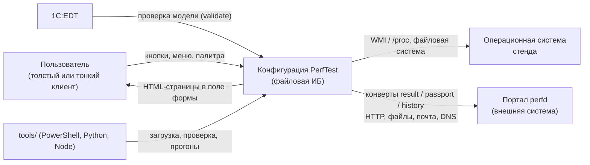
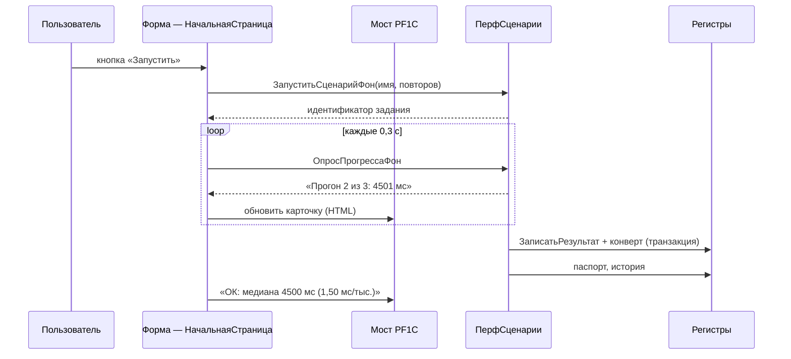

# Архитектура конфигурации PerfTest

| | |
|---|---|
| Документ | `02-Архитектура.md` |
| Тип | design (как устроено) |
| Статус | актуален |
| Проверено на версии | 1.42 |
| Дата ревизии | 11.11.2026 |
| Отвечает на вопрос | из каких частей состоит конфигурация, как они связаны и почему границы проведены именно так |
| Смежные документы | `01-ТЗ.md`, `03-Техническое_решение.md`, `../design/Реализация.md` (детали кода), `../design/Обмен_реализация.md` |

Документ описывает архитектуру **конфигурации** (сторона 1С). Устройство портала и сквозные
решения по системе — в `03-Техническое_решение.md`. Там, где архитектура конфигурации определяется
внешней системой (контракт приёмника, витрина), это отмечено.

Структура документа — по [arc42](https://arc42.org/overview) с диаграммами по
[C4](https://c4model.com/diagrams): цели, контекст, стратегия, блоки, сценарии выполнения,
данные, интерфейсы, качество, риски. Нумерация разделов arc42 не копируется: документ читается
подряд, а не сверяется со шаблоном.

## 1. Цели архитектуры

| Приоритет | Качество | Что значит на практике | Чем достигается |
|---|---|---|---|
| 1 | Воспроизводимость замера | одинаковые числа при повторном прогоне и на другом стенде того же класса | серверный замер, фиксированные порции, медиана по повторам, нормировка на порцию |
| 2 | Честность сравнения | сравнение не ломается при смене порции, темы, интерфейса | метрика «мс/тыс.», пометка «порция изменилась», отделение отрисовки от измерения |
| 3 | Переносимость | работает на Windows и Linux, в файловой и клиент-серверной ИБ, в толстом и тонком клиенте | определение среды, отсутствие WMI в обязательном пути, препроцессор для веб-клиента |
| 4 | Наблюдаемость | понятно, что сломалось: замер, паспорт, интерфейс или обмен | маркеры в лог, журнал ошибок, страница журнала обмена, самотест |
| 5 | Устойчивость к сбоям | падение обмена не теряет замер; падение одного сценария не останавливает очередь | транзакция «замер + конверт», очередь с повторами, барьер паспорта с таймаутом |

Порядок приоритетов объясняет компромиссы: замедление интерфейса ради точности замера допустимо,
потеря замера ради своевременной отправки — нет.

## 2. Заинтересованные стороны

| Сторона | Что ей нужно от архитектуры | Как учтено |
|---|---|---|
| Владелец стенда | запустить и получить сравнение без настройки | одна база, кнопка «запустить все», готовые отчёты |
| Разработчик конфигурации | менять поведение в одном месте | зоны ответственности модулей, контракты, гейты CI |
| Администратор контура | отправлять замеры на портал и видеть состояние | очередь с повторами, журнал обмена, 9 каналов, профиль среды |
| Читатель результатов (аналитик) | понимать, чем стенды отличались | паспорт стенда, поколения, история замеров |

## 3. Контекст системы (C4 уровень 1)



| Внешняя система | Направление | Что передаётся | Формат |
|---|---|---|---|
| Портал `perfd` | исходящее | результаты, паспорта, история | JSON-конверты, пакет в теле запроса |
| Портал `perfd` | входящее | подтверждения (ack) в файловом канале | файл `<id>.ack` |
| ОС стенда | чтение | процессор, память, диски, версии | WMI (Windows), `/proc` и `/sys` (Linux) |
| `1C:EDT` | входящее | модель конфигурации для проверки | XML-выгрузка формата 2.20 |
| Инструменты `tools/` | входящее | команды загрузки, проверки, прогонов | `/C` режимы, выгрузка в файлы |

Конфигурация не принимает входящих сетевых запросов: она клиент, а не сервис. Это ограничение
сознательное — публикация на веб-сервере и веб-клиент вне границ (см. `01-ТЗ.md` §3).

## 4. Стратегия решения

Три решения задают всё остальное:

1. **Измеряет только сервер.** Панель, автопрогон и автономная обработка вызывают одни и те же
   функции `ПерфСценарии`; метрики не считаются на клиенте. Иначе три пути разошлись бы в числах,
   а сравнение перестало бы быть сравнением.
2. **Рисует только HTML-слой.** Форма — оркестратор: держит состояние, вызывает серверные функции,
   кладёт готовый документ в поле HTML. Логика представления живёт в `ПерфUI`, `ПерфОтчетыHTML`,
   `ПерфСтендыHTML`, `ПерфКокпит`.
3. **Связь «страница → 1С» идёт через мост.** Одна точка обработки событий (`PF1C`, атрибуты
   `data-pf` и `data-pf-field`) вместо инлайновых обработчиков: переживает перерисовку, грепается,
   не требует правки разметки при изменении поведения.

Следствие: у архитектуры два такта. Медленный такт — замер (секунды, фон, чанки). Быстрый такт —
интерфейс (опрос моста, перерисовка блоков). Разделение тактов и даёт отзывчивость при честном
измерении.

## 5. Блоки (C4 уровень 2 и 3)

### 5.1. Контейнеры внутри конфигурации

| Контейнер | Что это | Ответственность |
|---|---|---|
| Интерфейс | 7 общих форм + HTML-поле | показать страницу, принять действие, вызвать сервер |
| Слой замера | `ПерфСценарии` | каталог, прогон, чанки, медиана, запись результата |
| Слой паспорта | `ПерфПаспорт`, `ПерфПаспортКлиент` | сбор среды, фазы, барьер, запись паспорта |
| Слой представления | `ПерфUI`, `ПерфОтчетыHTML`, `ПерфСтендыHTML`, `ПерфКокпит`, `ПерфОбменHTML` | HTML-документы страниц и палитра |
| Слой обмена | `ПерфОбмен`, `ПерфОбменТранспорт`, `ПерфОбменШифр` | очередь, каналы, подпись, шифрование |
| Слой среды | `ПерфСреда`, `ПерфСредаКлиент`, `ПерфПробаКлиент` | определить, где исполняется код, и запретить нерабочие каналы |
| Слой эксплуатации | `ПерфЖурнал`, `ПерфОбслуживание` | журнал ошибок, очистка, разбор журнала регистрации |
| Хранилище | 9 регистров сведений | результаты, история, паспорта, очередь, каналы, пробы, секреты, сертификат, ошибки |

### 5.2. Модули и их контракты

| Модуль | Экспорты (ключевые) | Зона | Запрещено |
|---|---|---|---|
| `ПерфСценарии` | `СписокСценариев`, `ВыполнитьПрогон`, `ВыполнитьЧанк`, `ЗапуститьСценарийФон`, `Медиана`, `ЗаписатьРезультат` | единственное место замера и записи результатов | рисовать HTML, знать про формы |
| `ПерфПаспорт` | `Обеспечить`, `ЗапуститьСборФон`, `СобратьФон`, `ЗаписатьПаспортСтенда` | паспорт среды и барьер | измерять |
| `ПерфПаспортКлиент` | клиентская строка паспорта | данные рабочего места | работать с COM на сервере |
| `ПерфUI` | `Документ`, `Стили`, `Страница`, `Плитка`, `Бейдж`, `Таблица`, `Меню`, `Шапка`, `СкриптМоста` | каркас документа, палитра, мост | бизнес-логика |
| `ПерфОтчетыHTML` | `ФорматЧисла`, сборка Р1–Р3, дашборд, `РассчитатьИндекс` | отчёты и расчёт ИИ | запись данных |
| `ПерфСтендыHTML` | карточка стенда, плитки каналов | паспорт как страница | измерять |
| `ПерфКокпит` | каркас страниц, `КарточкаHTML`, `СкриптКокпита` | навигация и JS кокпита | серверные вызовы |
| `ПерфОбмен` | `ПоставитьВОчередь`, `ОтправитьОчередь`, `ОтправитьОчередьФон`, `РегламентнаяОтправка` | очередь, выбор канала, идемпотентность, подпись | знать про формы |
| `ПерфОбменТранспорт` | `ОтправитьПакет`, `ДоступныеКаналы`, `ПробаКанала` | протоколы доставки | решать, что отправлять |
| `ПерфОбменШифр` | `Зашифровать`, `ВерсияOpenSSL` | CMS-конверт | сеть |
| `ПерфСреда` | `Определить`, `Отпечаток`, `Профиль`, `Применить` | определение среды и запреты каналов | разрешать каналы |
| `ПерфЖурнал` | `ЗаписатьОшибку`, `ОграничитьЖурнал`, `Очистить` | журнал ошибок | бросать исключения |

Правило зависимостей: слой представления может зависеть от слоя замера, но не наоборот; слой замера
не знает ни про HTML, ни про обмен — постановка конверта выполняется одной функцией
`ПерфОбмен.ПоставитьВОчередьРезультат` внутри транзакции записи результата.

### 5.3. Компоненты слоя замера

```text
СписокСценариев ──► ВыполнитьПрогон(Имя, Повторов)
                        │ для каждого повтора:
                        ├─ ВыполнитьЧанк × N  ← порция / чанк, прогресс
                        └─ Медиана(времена)
                              │
                              ▼
                        ЗаписатьРезультат
                              ├─ регистр ПерфРезультаты (ключ: стенд × платформа × сценарий)
                              ├─ конверт result → очередь (в той же транзакции)
                              ├─ паспорт стенда (после транзакции)
                              └─ регистр ПерфИстория (после транзакции)
```

Чанки нужны не для скорости, а для прогресса: один серверный вызов на весь прогон не даёт показать
«Чанк 3 из 10» и отменить работу в середине.

### 5.4. Компоненты слоя обмена

```text
ЗаписатьРезультат ─► ПоставитьВОчередьРезультат ─► регистр ПерфОчередьОбмена
                                                       │
РегламентнаяОтправка / старт сеанса / после прогона ────┤
                                                       ▼
                                              ОтправитьОчередь
                                                       │
                              ДоступныеКаналы(лестница по приоритету)
                                                       │
             HTTPS → HTTPS8443 → PROXY → HTTP80+CMS → WEBDAV → FTP/FTPS → SMTP → SFTP → DNS
                                                       │
                                код 200 → Отправлено; 401/400 → Ошибка;
                                сеть недоступна → Ожидает с паузой и повтором
```

Канал не выбран жёстко: лестница строится из регистра `ПерфОбменКанал` и сужается профилем среды
(`ПерфСреда.Профиль` — только запреты). Неверный канал не должен приводить к потере конверта,
поэтому транспортная ошибка возвращает запись в «Ожидает», а не в «Ошибка».

## 6. Сценарии выполнения

### 6.1. Интерактивный прогон одной карточки



### 6.2. «Запустить все»

Очередь карточек, затем `СледующаяИзОчереди` → барьер паспорта (0,5 с) → фон → `ЗавершитьПрогон`
→ `ЗавершитьКарточку` → следующая. Повторная команда во время прогона отклоняется guard'ом: иначе
второй прогон шёл бы параллельно и первый результат терялся.

### 6.3. Паспорт стенда

Быстрая фаза (версии, режим ИБ, `СистемнаяИнформация`) — сразу; полная фаза — фоновым заданием
(WMI или `/proc`), запись поколениями. Барьер `Обеспечить(Стенд, Строка, Ждать)` не блокирует замер:
при таймауте пишется быстрая фаза, замер стартует, а полнота помечается в замечаниях.

### 6.4. Открытие страницы

Форма вызывает серверную функцию сборки HTML (один вызов), кладёт строку в поле. Дальше страница
живёт на клиенте: навигация и команды идут через мост, серверные данные запрашиваются новым
вызовом при переходе. Таймер опроса моста работает только пока страница открыта.

## 7. Модель данных

| Регистр | Измерения | Ресурсы и реквизиты | Роль |
|---|---|---|---|
| `ПерфРезультаты` | Стенд, ВерсияПлатформы, Сценарий | МедианаМс, НаЕдиницуМс, Порция, Единица, Повторов, МинМс, МаксМс, ДатаЗамера | текущая таблица сравнения |
| `ПерфИстория` | Стенд, Сценарий, ДатаЗамера | те же метрики | ряд для графиков, без перезаписи |
| `ПерфСтенды` | Стенд | 71 реквизит паспорта, схема 3 | описание среды замера |
| `ПерфОчередьОбмена` | Идентификатор конверта | вид, тело, статус, попытки, пометка отправки | надёжная доставка |
| `ПерфОбменКанал` | Канал | порт, приоритет, включён, примечание | настройка лестницы |
| `ПерфОбменПроба` | Канал | годен до, результат, текст | плитки доступности |
| `ПерфОбменСекрет` | Ключ | значение | токен, HMAC, пароли каналов |
| `ПерфОбменСертификат` | Назначение | PEM | доверие TLS и CMS |
| `ПерфОшибки` | — | контекст, сообщение, тяжесть | наблюдаемость |

Ключи выбраны так, чтобы повторный замер обновлял сравнение, но не стирал историю: две таблицы с
разными ключами вместо одной с флагом «актуально».

## 8. Интерфейсы

| Интерфейс | Где | Контракт |
|---|---|---|
| HTML-поле | формы | полный HTML-документ (`<html><body>…`), один вызов на страницу |
| Мост `PF1C` | вставляется в `<head>` | команды `open:`, `run:`, `send:`, `pal`, `palpick:`, `theme`, `close`; поля через `data-pf-field` |
| Серверные функции | общие модули | структуры с числами и текстом; исключения не выходят наружу молча |
| Очередь обмена | `ПерфОбмен` | конверт неизменяем после постановки; повтор не создаёт дубликат |
| Служебные режимы | `/C` параметр | текстовые маркеры в `%TEMP%`, пригодные для машинной проверки |

## 9. Качественные сценарии (проверяемые)

| Сценарий | Ожидаемое поведение | Проверка |
|---|---|---|
| Второй клик по «Запустить все» во время прогона | команда отклоняется, первый прогон не страдает | маркер «прогон уже идёт» |
| Портал недоступен | замер записан, конверт в очереди, повтор позже | `exchange-net`, очередь растёт |
| WMI завис | паспорт с быстрой фазой, замер идёт | поле «полный сбор не завершён» |
| Тонкий клиент, обращение к серверному объекту в модуле приложения | ошибки нет, потому что обращений нет | EDT-проверка + прогон тонким клиентом |
| Смена порции в каталоге | старые замеры не сравниваются молча | пометка «порция изменилась» |
| Нет `pscp` на Linux | канал SFTP выключен профилем, остальные работают | журнал обмена, маркер `env:apply` |

## 10. Риски и технический долг

| Риск | Влияние | Что делаем |
|---|---|---|
| Файловая ИБ: фон и замер в одном процессе | автодосылка во время прогона искажает числа | отправка не запускается при активном прогоне |
| Клиент-серверный вариант и Linux проверены частично | ложное «работает» на другой среде | профиль среды и честная пометка «не проверено» |
| HTML-поле не покрывает 1С-элементы | часть интерфейса нельзя сделать в едином стиле | гибрид: шапка и статусы в HTML, кнопки — нативные |
| Замечания EDT: запросы в цикле | потенциальная деградация на больших объёмах | принято осознанно для сценариев замера |
| Документация расходилась с кодом | ложные выводы при сопровождении | шапки со статусом, гейты CI, реестр проверок |

## 11. Глоссарий

Сценарий, порция, единица, медиана, «мс/тыс.», стенд, паспорт стенда, ИИ, чанк — определения в
`../spec/ТЗ.md` §2. Конверт, поколение стенда, лестница каналов, спул, ack — в
`../design/Обмен_реализация.md` §4 и `03-Техническое_решение.md` §6.
